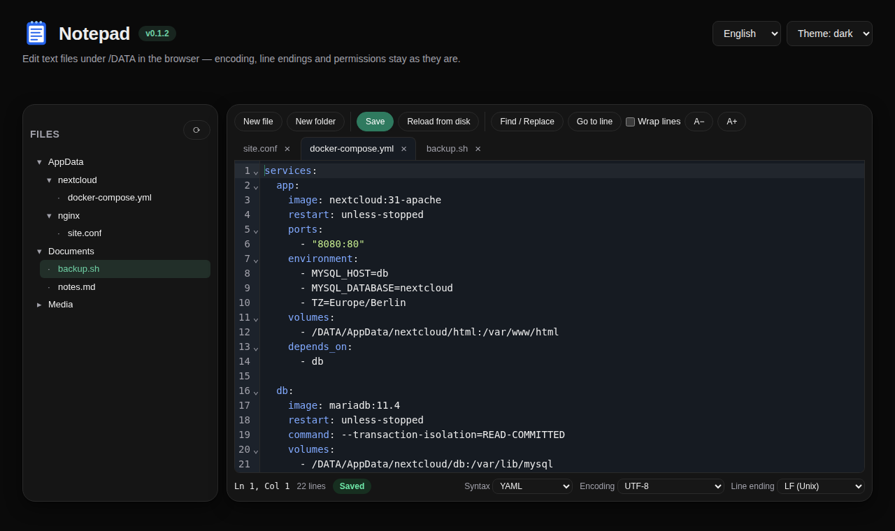

# Notepad — text editor for ZimaOS

A Notepad++-style editor for the files on your ZimaOS box, right in the
dashboard. Open a `.conf`, a `docker-compose.yml`, a script or a log under
`/DATA`, edit it in tabs with syntax highlighting, and save it — the file keeps
its encoding, its line endings and its permissions.

Ships as a systemd-sysext module (`notepad.raw`) built with
[lintux-modkit](https://github.com/chicohaager/lintux-modkit), like the other
Lintux modules. Changes per version: [CHANGELOG](CHANGELOG.md).



<p>
  
  
</p>

## Features

- **File tree** of `/DATA`; new file and new folder in the selected folder.
- **Tabs** with an unsaved-changes marker; closing or leaving with unsaved
  changes asks first.
- **Syntax highlighting** for 24 languages, chosen from the file name: YAML,
  JSON, INI/`.conf`/systemd units, shell, Nginx, Dockerfile, TOML, Markdown,
  HTML, CSS, JavaScript/TypeScript, Python, Go, Rust, C/C++, Java, PHP, SQL,
  XML, Lua, Perl, PowerShell, diff.
- **Find and replace** (regular expressions, case, whole word), **go to line**,
  bracket matching, code folding, multiple cursors, line wrap, font size.
- **Saving that changes only what you changed**
  - Encoding detected and kept: UTF-8 (with or without BOM), UTF-16 LE/BE,
    Windows-1252. A character the encoding cannot store is refused with its
    line number instead of being lost; switch the encoding in the status bar.
  - Line endings LF, CRLF or CR detected and kept (mixed endings are reported).
  - Written in place, so the file keeps its inode, mode, owner and group — a
    container that mounts this one file sees the change. The old content is
    copied aside first and written back if saving fails (like Vim's
    `backupcopy=yes`).
  - **Conflict check**: if another program changed the file since you opened
    it, saving asks whether to overwrite or reload. A file deleted or renamed
    meanwhile can be created again with the text of the tab.
  - A **write-protected** file (no write permission) opens read-only.
- **Reload from disk** button; Ctrl+S save, Ctrl+F find, Ctrl+G go to line.
- Files up to **32 MiB**; binary files (NUL bytes) are not opened.
- **Five languages** — English, German, French, Spanish, Chinese; follows the
  language of the ZimaOS shell, switchable in the header.
- **Light and dark theme** in the design of ZFW and the other Lintux modules;
  works on a phone (file tree behind a button).

## Security

- Every API call needs a valid ZimaOS session token (checked against the
  platform's keys) of the administrator: a ZimaOS sub-account gets 403 and the
  tile says that only the administrator may edit files. Cross-origin writes are
  rejected.
- The service runs as root like the other modules, so it can edit any file
  under `/DATA` and keep its owner. Access is confined to `/DATA` by an
  `os.Root` handle: every open resolves symlinks beneath `/DATA` only, so a
  symlink swapped in while a file is opened or saved cannot redirect the access
  elsewhere. Each file is opened once and read, checked and written through
  that one descriptor; new files and folders get their mode and owner on their
  own descriptor. A symlink pointing outside `/DATA` is shown greyed out and
  cannot be opened; an absolute symlink to a place inside `/DATA` works.
- At most two large texts are read or written at the same time, which bounds
  the memory a burst of requests can take.

## Installation

Requires ZimaOS 1.8 on amd64 or arm64.

With the [Module Manager](https://github.com/chicohaager/modmanager) (0.3.3 or
later): tab **Catalog**, **Notepad**, **Install** — it checks the release
checksum and refuses an image that would replace files of ZimaOS. With an older
Module Manager, add the repository `chicohaager/zima-notepad` in the catalog.

By hand, on the host (for an ARM box replace `amd64` with `arm64`):

```sh
cd /tmp
curl -fsSLO https://github.com/chicohaager/zima-notepad/releases/latest/download/notepad-amd64.raw
curl -fsSLO https://github.com/chicohaager/zima-notepad/releases/latest/download/notepad-amd64.raw.sha256
sha256sum -c notepad-amd64.raw.sha256
mv notepad-amd64.raw notepad.raw            # zpkg takes the module name from the file name
sudo zpkg install /tmp/notepad.raw
```

The tile appears in the dashboard as **Notepad**. The module keeps no data of
its own (theme, font size and open tabs live in the browser), so
`sudo zpkg remove notepad` removes it completely.

## Development

```sh
sh dev.sh          # http://127.0.0.1:8471/modules/notepad/ — sample data, no login, loopback only
sh check.sh        # gofmt, go vet, go test, translations, editor bundle, browser test, bind-mount test
sh build.sh amd64  # dist/notepad-amd64.raw (+ notepad.raw); arm64 likewise
~/.venvs/playwright/bin/python3 tools/screenshots.py   # docs/screenshots/*.png from made-up demo files
```

Needs Go 1.27, Node.js with npm, Python with Playwright for the browser test,
Docker for the bind-mount test and `squashfs-tools` for the image. The build
expects a checkout of lintux-modkit next to this one (`../lintux-modkit`) at the
commit named in `lintux-modkit.ref`; `build.sh` refuses another one
(`MODKIT_DEV=1` allows a development build). The editor is CodeMirror 6, bundled with esbuild at build time; the
licences of all bundled packages are in `/usr/share/doc/notepad/THIRD-PARTY.txt`
inside the image.

## Licence

MIT — see [LICENSE](LICENSE).
