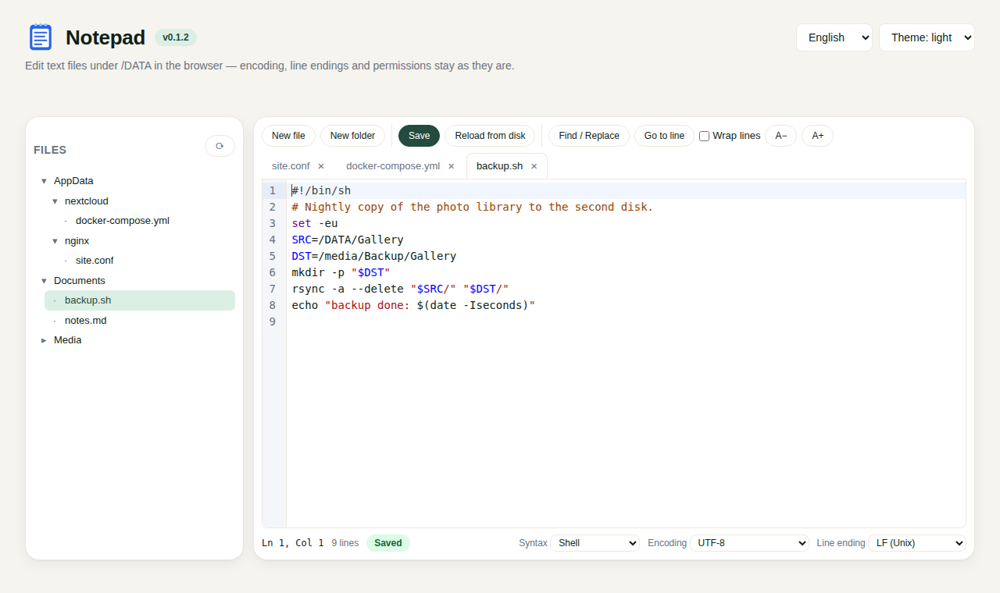
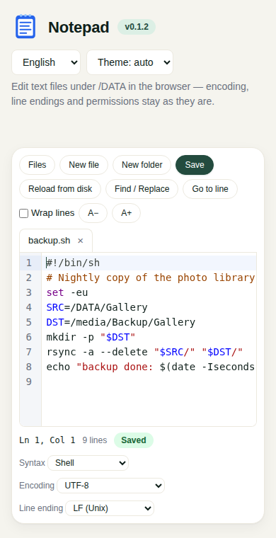

# Notepad — text editor for ZimaOS

A Notepad++-style editor for the files on your ZimaOS box, right in the
dashboard. Open a `.conf`, a `docker-compose.yml`, a script or a log under
`/DATA`, edit it in tabs with syntax highlighting, and save it — the file keeps
its encoding, its line endings and its permissions.

Ships as a systemd-sysext module (`notepad.raw`) built with
[lintux-modkit](https://github.com/chicohaager/lintux-modkit), like the other
Lintux modules. Changes per version: [CHANGELOG](CHANGELOG.md).


<p>
  
  
</p>

## Features

- **File tree** of `/DATA`; new file and new folder in the selected folder. Hidden and system entries
  (dot names, `lost+found`) stay out of sight until you tick **Show hidden**.
- **Tabs** with an unsaved-changes marker; closing or leaving with unsaved
  changes asks first.
- **Syntax highlighting** for 25 languages, chosen from the file name: YAML,
  JSON, INI/`.conf`/systemd units, shell, Nginx, Dockerfile, TOML, Markdown,
  HTML, CSS, JavaScript/TypeScript, Python, Go, Rust, C/C++, Java, PHP, SQL,
  XML, Lua, Perl, PowerShell, CMake (`CMakeLists.txt`, `.cmake`), diff; any
  other file opens as plain text, and the status bar switches the syntax by hand.
- **Find and replace** (regular expressions, case, whole word), **go to line**,
  bracket matching, code folding, multiple cursors, line wrap, font size.
- **Saving that changes only what you changed**
  - Encoding detected and kept: UTF-8 (with or without BOM), UTF-16 LE/BE,
    Windows-1252. A file that is none of the first three is read as
    Windows-1252; when its bytes look like another encoding (Chinese, Japanese,
    Korean, Cyrillic), the status bar says **Encoding guessed**. German, French
    or Spanish ANSI files open without that note.
  - **Reopen with encoding**: pick GB18030, GBK, Big5, Shift_JIS, EUC-JP,
    EUC-KR, Windows-1250/1251, ISO-8859-2/-5/-15 or KOI8-R in the status bar
    and choose *Reopen* to read the same bytes in it (or *Convert on save* to
    write the text in it). Bytes that are not valid in the chosen encoding open
    the file view-only, so saving cannot change them. The tab remembers the
    choice across a page reload.
  - A character the encoding cannot store is refused with its line number
    instead of being lost.
  - Line endings LF, CRLF or CR detected and kept (mixed endings are reported).
  - Written in place, so the file keeps its inode, mode, owner and group — a
    container that mounts this one file sees the change. The old content is
    copied aside first and written back if saving fails (like Vim's
    `backupcopy=yes`).
  - **Conflict check**: if another program changed the file since you opened
    it, saving asks whether to overwrite or reload. A file deleted or renamed
    meanwhile can be created again with the text of the tab.
  - A **write-protected** file (no write permission) opens read-only.
- **Reload from disk** button; Ctrl+S save, Ctrl+F find, Ctrl+G go to line.
- Files up to **32 MiB**; binary files (NUL bytes) are not opened.
- **Five languages** — English, German, French, Spanish, Chinese; follows the
  language of the ZimaOS shell, switchable in the header.
- **Light and dark theme** in the design of ZFW and the other Lintux modules;
  works on a phone (file tree behind a button).

## Which files open

**Any text file up to 32 MiB under `/DATA` opens** — the file extension decides only the
syntax colours, never whether a file opens. Files with NUL bytes (images, PDFs, archives,
Office documents, databases, executables) are refused as binary.

### Encodings

| Encoding | Detected automatically | Can be chosen (Reopen / Convert on save) |
|---|---|---|
| UTF-8 | ✓ | ✓ |
| UTF-8 with BOM | ✓ | ✓ |
| UTF-16 LE / BE (with BOM) | ✓ | ✓ |
| Windows-1252 (Western "ANSI") | ✓ — the fallback for everything that is not UTF-8 | ✓ |
| Windows-1250, ISO-8859-2 (Central European) | — | ✓ |
| Windows-1251, ISO-8859-5, KOI8-R (Cyrillic) | — | ✓ |
| ISO-8859-15 (Western with €) | — | ✓ |
| GB18030, GBK (Simplified Chinese) | — | ✓ |
| Big5 (Traditional Chinese) | — | ✓ |
| Shift_JIS, EUC-JP (Japanese) | — | ✓ |
| EUC-KR (Korean) | — | ✓ |

A file without BOM that is not UTF-8 is read as Windows-1252. If its bytes look like
Chinese, Japanese, Korean or Cyrillic text, the status bar shows **Encoding guessed**: pick
the right encoding there and choose **Reopen**. Central European files often look like
Western text to the detection (Polish ISO-8859-2 always, Czech Windows-1250 in about half of
the tested texts) and then get no note — reopen them by hand. Line endings LF, CRLF and CR are
detected and kept.

### Syntax highlighting

The match ignores upper and lower case. Every other file opens as plain text (`.txt`, `.log`,
`.csv`, files without extension …); the **Syntax** menu in the status bar switches any file
to any of these by hand.

| Syntax | Extensions | File names |
|---|---|---|
| JavaScript | `.js` `.mjs` `.cjs` `.jsx` | |
| TypeScript | `.ts` `.tsx` | |
| JSON | `.json` `.jsonc` `.webmanifest` | |
| YAML | `.yml` `.yaml` | `docker-compose.yml`, `compose.yaml` |
| Python | `.py` | |
| Markdown | `.md` `.markdown` | |
| HTML | `.html` `.htm` `.vue` | |
| CSS | `.css` `.scss` `.less` | |
| XML | `.xml` `.svg` `.plist` `.xsd` | |
| SQL | `.sql` | |
| PHP | `.php` | |
| Go | `.go` | |
| Rust | `.rs` | |
| C/C++ | `.c` `.h` `.cc` `.cpp` `.hpp` | |
| Java | `.java` `.kt` | |
| Shell | `.sh` `.bash` `.zsh` `.env` `.profile` `.bashrc` | `Makefile`, `.bashrc`, `.profile`, `.env` |
| Nginx | | `nginx.conf`, any `*nginx*.conf` |
| Dockerfile | | `Dockerfile`, `Dockerfile.*`, `Containerfile` |
| TOML | `.toml` | |
| INI / Properties | `.ini` `.conf` `.cfg` `.properties` `.service` `.timer` `.mount` `.network` `.desktop` | |
| Diff | `.diff` `.patch` | |
| Lua | `.lua` | |
| Perl | `.pl` | |
| PowerShell | `.ps1` `.psm1` | |
| CMake | `.cmake` | `CMakeLists.txt` |

## Security

- Every API call needs a valid ZimaOS session token (checked against the
  platform's keys) of the administrator: a ZimaOS sub-account gets 403 and the
  tile says that only the administrator may edit files. Cross-origin writes are
  rejected.
- The service runs as root like the other modules, so it can edit any file
  under `/DATA` and keep its owner. Access is confined to `/DATA` by an
  `os.Root` handle: every open resolves symlinks beneath `/DATA` only, so a
  symlink swapped in while a file is opened or saved cannot redirect the access
  elsewhere. Each file is opened once and read, checked and written through
  that one descriptor; new files and folders get their mode and owner on their
  own descriptor. A symlink pointing outside `/DATA` is shown greyed out and
  cannot be opened; an absolute symlink to a place inside `/DATA` works.
- At most two large texts are read or written at the same time, which bounds
  the memory a burst of requests can take.

## Installation

Requires ZimaOS 1.8 on amd64 or arm64.

With the [Module Manager](https://github.com/chicohaager/modmanager) (0.3.3 or
later): tab **Catalog**, **Notepad**, **Install** — it checks the release
checksum and refuses an image that would replace files of ZimaOS. With an older
Module Manager, add the repository `chicohaager/zima-notepad` in the catalog.

By hand, on the host (for an ARM box replace `amd64` with `arm64`):

```sh
cd /tmp
curl -fsSLO https://github.com/chicohaager/zima-notepad/releases/latest/download/notepad-amd64.raw
curl -fsSLO https://github.com/chicohaager/zima-notepad/releases/latest/download/notepad-amd64.raw.sha256
sha256sum -c notepad-amd64.raw.sha256
mv notepad-amd64.raw notepad.raw            # zpkg takes the module name from the file name
sudo zpkg install /tmp/notepad.raw
```

To update an installed Notepad by hand, download and check the new image the same
way, then replace it and restart the service — `--force` alone replaces the file
but leaves the old process running:

```sh
sudo zpkg install --force /tmp/notepad.raw
sudo systemctl restart notepad-web
```

The tile appears in the dashboard as **Notepad**. The module keeps no data of
its own (theme, font size and open tabs live in the browser), so
`sudo zpkg remove notepad` removes it completely.

### Opening a file from the Files app

`/modules/notepad/?open=/DATA/<path>` opens that file in a tab;
`/modules/notepad/?new=/DATA/<folder>` asks for a name and creates a text file
there. Both work for links and bookmarks.

The ZimaOS Files app has no extension point for its menus, so an "Open with
Notepad" entry there needs a change to IceWhale's code. `tools/files-menu/`
builds a separate, optional sysext `notepad-files-menu` for your own hosts: it
overlays patched copies of the Files bundles that add "Open with Notepad" to the
right-click and three-dot menu of a file on ZimaOS-HD (`/DATA`), and "New text
file" after "New folder" in the menu of the empty area and in the drop-down of
the new-folder button. The Files list shows the new file after **Refresh**. It
is not part of the release, works only for the Files builds it was made from,
and after a Files update the entries are gone (the Files app itself keeps
working) until it is rebuilt from the new bundles:

```sh
scp '<user>@<host>:/usr/share/casaos/www/modules/icewhale_files/assets/Files-*.js' /tmp/files/
scp '<user>@<host>:/usr/share/casaos/www/modules/icewhale_files/assets/main-*.js' /tmp/files/
sh tools/files-menu/build.sh amd64 /tmp/files/*.js   # build/files-menu/out/notepad-files-menu-amd64.raw
# on the host, after copying the image to /tmp/notepad-files-menu.raw:
sudo zpkg install /tmp/notepad-files-menu.raw   # remove: sudo zpkg remove notepad-files-menu
```

A browser that loaded the Files app before may keep the old bundle for a while
(the server sends it without `Cache-Control`); a hard reload fetches the new one.

## Development

```sh
sh dev.sh          # http://127.0.0.1:8471/modules/notepad/ — sample data, no login, loopback only
sh check.sh        # gofmt, go vet, go test, translations, editor bundle, browser test, bind-mount test
sh build.sh amd64  # dist/notepad-amd64.raw (+ notepad.raw); arm64 likewise
~/.venvs/playwright/bin/python3 tools/screenshots.py   # docs/screenshots/*.png from made-up demo files
```

Needs Go 1.27, Node.js with npm, Python with Playwright for the browser test,
Docker for the bind-mount test and `squashfs-tools` for the image. The build
expects a checkout of lintux-modkit next to this one (`../lintux-modkit`) at the
commit named in `lintux-modkit.ref`; `build.sh` refuses another one
(`MODKIT_DEV=1` allows a development build). The editor is CodeMirror 6, bundled with esbuild at build time; the
licences of all bundled packages are in `/usr/share/doc/notepad/THIRD-PARTY.txt`
inside the image.

## Licence

MIT — see [LICENSE](LICENSE).
